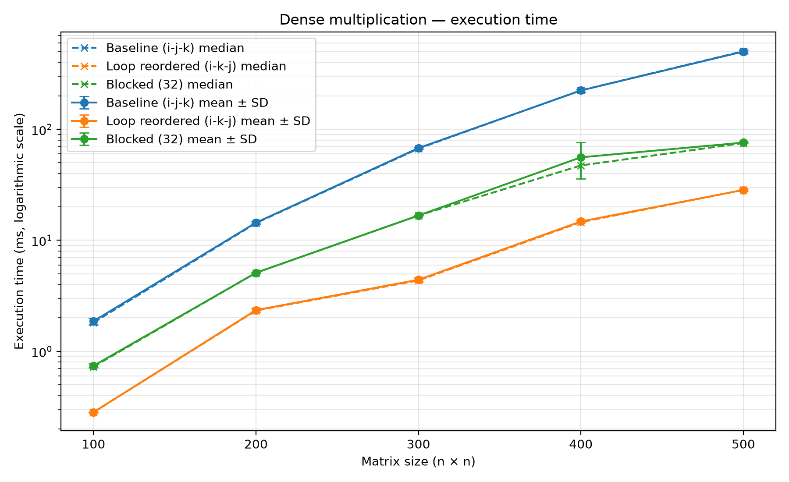
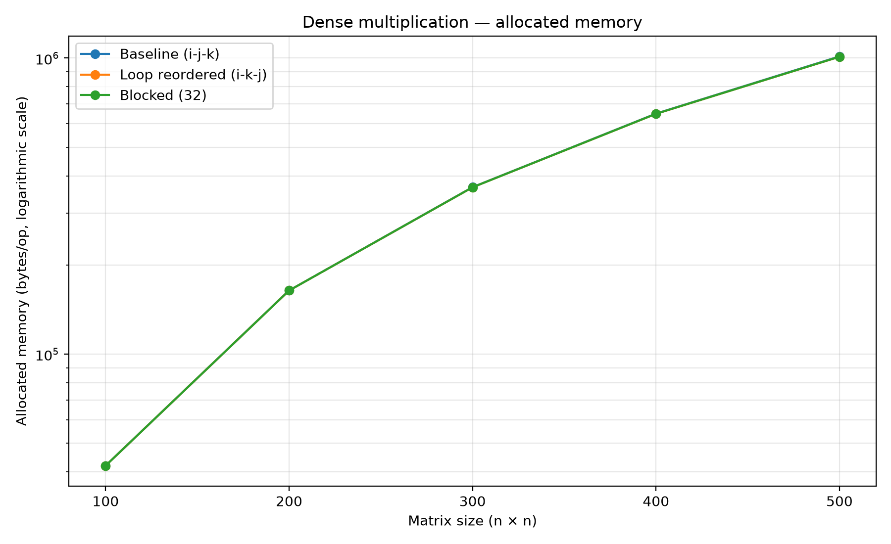
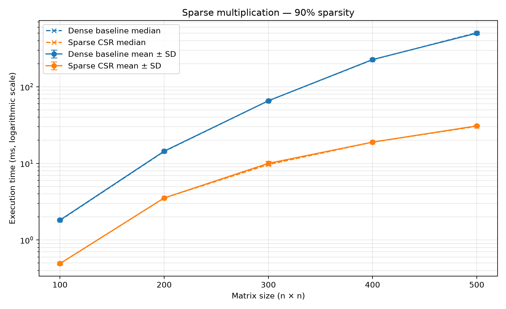
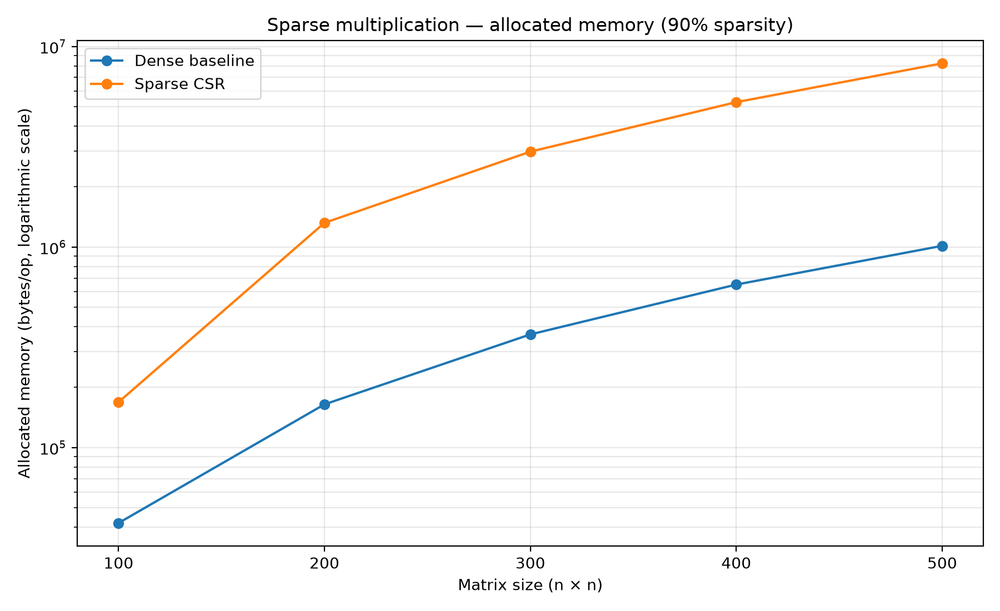

# Matrix Multiplication: Dense Optimisation and Sparse Matrices (Assignment 2)

This project extends the validated basic matrix multiplication from Assignment 1. It investigates two questions: whether loop reordering and cache blocking improve dense multiplication, and how a sparse CSR representation performs compared with dense multiplication when the input matrices contain many zero entries.

The dense algorithms use the same integer arithmetic and sequential execution. The sparse experiment compares the dense baseline against a custom Compressed Sparse Row (CSR) implementation using the same logical input matrices.

## Project structure

The repository contains the Java implementation and a Python results plotter.

```text
Optimised-Matrix-Multiplication-Approaches-and-Sparse-Matrices/
├── Optimised Matrix Multiplication Approaches and Sparse Matrices/
│   ├── pom.xml
│   └── src
│       ├── main/java/control/
│       │   ├──  MatrixGenerator.java
│       │   ├──  MatrixMultiplier.java
│       │   ├──  MatrixPrinter.java
│       │   └──  CSRMatrix.java
│       └── test/java/benchmark/
│           ├── CorrectnessTest.java
│           ├── DenseBenchmarkRunner.java
│           ├── SparseBenchmarkRunner.java
│           └── BenchmarkMain.java
├── Results Plotter/
│   └── main/                         # Python analysis and plotting scripts
│       ├── control/
│       │   └── csv_manager.py
│       └── main.py
├── results.csv                       # Generated summary results
├── jmh_raw.json                      # Generated JMH results
├── results/
│   └── plots/                        # Generated figures
└── README.md
```

The input CSV file must be in the **repository root** when generated, alongside this README. A sample CSV file and its graphs are provided.

## Implementations

### Part A — Dense multiplication

Three sequential methods are compared:

- **`baseline`**: the original `i-j-k` triple-loop algorithm.
- **`loop_reordered`**: reorders the loops to `i-k-j`, allowing more contiguous access to rows of the second matrix and output matrix.
- **`blocked`**: divides the computation into blocks to try to improve cache locality. The current default block size is 32.

All three methods perform cubic arithmetic work, O(n³). The purpose of the experiments is to measure the effect of memory access patterns, not to assume that either optimisation will always be faster.

### Part B — Sparse multiplication

The sparse experiment compares:

- **`dense_baseline`**: the original dense multiplication algorithm applied to matrices whose entries are mostly zero.
- **`csr`**: multiplication of two matrices represented in Compressed Sparse Row (CSR) format.

CSR stores the non-zero values, their column indices and an array of row pointers. This avoids explicitly storing every zero in the input matrices. The dense-to-CSR conversion is performed during benchmark setup and is excluded from the timed multiplication. Therefore, the measured CSR time represents the multiplication itself, not the total cost of converting dense inputs and multiplying them.

The configured matrix sizes are 100, 200, 300, 400 and 500. Sparse experiments use sparsity values of 0.90, 0.95 and 0.99. A sparsity value of 0.90 means that approximately 90% of entries are zero, corresponding to approximately 10% density. The realised fraction can differ slightly because entries are generated probabilistically.

## Requirements

- **Java:** JDK 21 or a compatible project configuration.
- **Maven:** for resolving dependencies and compiling the project.
- **JMH:** version 1.37, declared in the Maven configuration.
- **Python plotting dependency:** Matplotlib.

Install the plotting dependency, if needed, with:

```bash
python -m pip install matplotlib
```

## How to run the project

### 1. Check correctness first

In IntelliJ IDEA, run `benchmark.CorrectnessTest` as a Java application. It checks a multiplication with known results, identity and zero matrix properties, and equality between the dense and CSR results on sparse inputs.

The expected output is:

```text
All Assignment correctness checks passed.
```

### 2. Run the benchmarks

Run `benchmark.BenchmarkMain` from IntelliJ IDEA.

The current benchmark configuration uses:

- 1 warm-up iteration of 1 second.
- 5 measurement iterations of 1 second each.
- 1 fork.
- 1 benchmark thread.
- JMH `GCProfiler` for allocation measurements.
- Average time mode in milliseconds.

The benchmark uses `Blackhole` to consume the result so that the computation is not discarded as unused work. Matrix generation is performed in `@Setup(Level.Trial)`, outside the timed multiplication.

### 3. Generated files

The Java test class generates two files in the run configuration's working directory:

- `results.csv`: one summary row per benchmark configuration.
- `jmh_raw.json`: JMH's raw result output, which should be retained for verification and reproducibility.

Keep both files. The CSV is convenient for plots and tables; the JSON retains the JMH result details.

## CSV format

The summary file uses these columns:

```csv
experiment,method,matrix_size,sparsity,block_size,numeric_type,warmup_iterations,measurement_iterations,threads,mean_time_ms,median_time_ms,variance_time_ms2,allocated_bytes_per_op,input_nnz_a,input_nnz_b,output_nnz
```

| Column | Meaning |
|---|---|
| `experiment` | `dense` or `sparse`. |
| `method` | `baseline`, `loop_reordered`, `blocked`, `dense_baseline` or `csr`. |
| `matrix_size` | Side length n of the n × n matrices. |
| `sparsity` | Requested zero-entry fraction; blank for dense optimisation experiments. |
| `block_size` | Blocking parameter; currently 32 for `blocked`, blank for other methods. |
| `numeric_type` | Integer arithmetic (`int`). |
| `warmup_iterations` | Number of warm-up iterations. |
| `measurement_iterations` | Number of measured iterations. |
| `threads` | Number of benchmark threads. |
| `mean_time_ms` | Mean execution time per operation, in milliseconds. |
| `median_time_ms` | 50th percentile of the JMH primary result. |
| `variance_time_ms2` | Variance of the measured primary results in ms². |
| `allocated_bytes_per_op` | Bytes allocated per operation (`B/op`), reported by `GCProfiler`. |
| `input_nnz_a`, `input_nnz_b` | Number of non-zero entries in the two sparse input matrices. Blank for dense experiments. |
| `output_nnz` | Number of non-zero entries in the sparse product. Blank for dense experiments. |

The sparse non-zero counts are calculated using the same size, sparsity and seeds as the corresponding benchmark inputs. The product can be denser than either input, so input sparsity alone is not enough to predict the storage or performance of the output.

## Experimental protocol and reproducibility

### Input generation

Dense inputs use integer values from 0 to 99 and fixed seeds 777 and 778. Sparse inputs use the requested sparsity and non-zero integer values from 1 to 9, with seeds 777 and 778. The dense baseline and CSR method in the sparse experiment use the same logical input matrices for each configuration. The generator makes runs reproducible for a given seed and implementation.

### Timing and memory

The multiplication result allocation is inside the timed operation. Input generation and dense-to-CSR conversion are outside the timed region. The result is consumed by JMH's `Blackhole`.

Five JMH measurement iterations are used per configuration, following one warm-up iteration. These iterations are not five individual multiplication samples: JMH aggregates operation timing within each iteration. Preserve the raw JSON alongside the summary CSV. The summary reports a mean, median and variance of the primary JMH results.

`allocated_bytes_per_op` is the normalised allocation metric `gc.alloc.rate.norm` from `GCProfiler`. It represents bytes allocated per benchmark operation. For the CSR benchmark it includes allocations performed by the CSR multiplication, but excludes the conversion performed during setup.

### Correctness and arithmetic

Run the correctness checks before benchmarking. The dense optimisations and CSR method should return the same integer result as the baseline for equivalent inputs. The current implementation uses Java `int` arithmetic, so integer overflow must be considered if input sizes or value ranges are increased.

### Environment

Record the actual system and versions used for the final run:

| Item | Value |
|---|---|
| Operating system and version | Windows 11 Home 25H2 |
| CPU model | 11th Gen Intel(R) Core(TM) i5-11400H @ 2.70GHz |
| Physical cores / logical processors | 6 / 12 |
| Installed RAM | 7,65 GB |
| Java JDK version | 21.0.12.1 |
| JMH version | 1.37 |

## Plotting the results

The plotting script supplied with the project can generate figures from `results.csv` running `main.py` in Python. The script should create a time comparison for dense methods and comparisons of dense-baseline versus CSR performance at each sparsity level.

### Dense execution time



### Dense allocation



### Sparse execution time



### Sparse allocation



## Repository and submission contents

The repository should include the Java source code, Maven configuration, correctness test, benchmark runners, results plotter, this README and sample results of executing the code: `results.csv`, `jmh_raw.json` and generated figures. Include the exact input-generation settings and run instructions so that the experiment can be reproduced.

## AI assistance disclosure

> **AI tool:** [Chat GPT]
>
> **Purpose:** [Improve redaction, speed up code writing]
>
> **Parts affected:** [Different parts of the code, README and report]
>
> **Validation:** [The code was refactored and rewritten after use, the README and report were initially handwritten and then checked]
